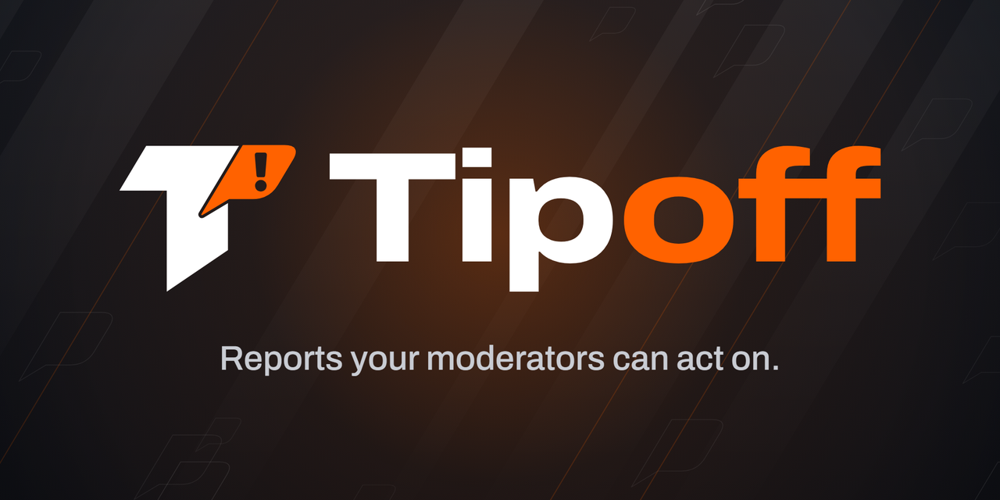

<div align="center">
  

  <h1>Tipoff</h1>

  <p><strong>A Discord report bot: members report a message or a member in two clicks, and every report becomes a case your moderators can claim, resolve and act on, without leaving Discord.</strong></p>

  <p>
    <a href="https://github.com/pigeon-studios-uk/tipoff/releases/latest"></a>
    <a href="LICENSE.md"></a>
    
    
    
  </p>

  <p>
    <a href="https://pigeonstudios.co.uk/apps/tipoff/invite/"><strong>Add Tipoff to your server</strong></a> ·
    <a href="#running-your-own-copy">Run your own</a> ·
    <a href="https://railway.com/deploy/tipoff?referralCode=uCs8YK&utm_medium=integration&utm_source=template&utm_campaign=generic">Deploy on Railway</a> ·
    <a href="#configuration">Configure</a> ·
    <a href="CHANGELOG.md">Changelog</a> ·
    <a href="https://pigeonstudios.co.uk/apps/tipoff/guide/">Guide</a>
  </p>
</div>

---

> [!TIP]
> **You probably don't need to run your own.** Tipoff is free to add to any server, already hosted and kept up to date for you: [add Tipoff to your server](https://pigeonstudios.co.uk/apps/tipoff/invite/), then run `/setup channels`. This repository is for people who want to read the code, or run a copy of it themselves.

## Contents

- [Overview](#overview)
- [Features](#features)
- [Running your own copy](#running-your-own-copy)
- [Requirements](#requirements)
- [Getting started](#getting-started)
- [Configuration](#configuration)
- [Inviting your bot](#inviting-your-bot)
- [Setting it up in your server](#setting-it-up-in-your-server)
- [Languages](#languages)
- [Updating](#updating)
- [How it works](#how-it-works)
- [Security and privacy](#security-and-privacy)
- [Troubleshooting](#troubleshooting)
- [FAQ](#faq)
- [Support](#support)
- [Contributing](#contributing)
- [Licence](#licence)
- [Credits](#credits)

## Overview

Tipoff is a free report bot for Discord by [Pigeon Studios](https://pigeonstudios.co.uk). Members report from Discord's own right-click menu, and your moderators get a **case**: one card in a channel of your choice with the evidence, who reported it, the member's history and buttons to deal with it. Reports about the same thing join one case instead of flooding the channel, and the evidence is saved even if the message is deleted.

It needs only Discord's **Guilds** intent. It never reads your server's messages or member list: everything a report needs arrives with the report itself.

The website has the full picture, with a working demo: **[pigeonstudios.co.uk/apps/tipoff](https://pigeonstudios.co.uk/apps/tipoff/)**. Everything Tipoff does is explained in the **[guide](https://pigeonstudios.co.uk/apps/tipoff/guide/)**, which applies to your own copy too.

## Features

- **Two-click reporting.** Right-click a message or a member › **Apps** › **Report Message** or **Report User**, or `/report` for anything else, with up to 5 screenshots.
- **Cases, not pings.** Reports about the same message or member join one numbered case while it's open, with every reporter listed.
- **Evidence kept as it was.** Text, embeds, stickers, polls, replies, forwards and attachments are saved on the case, even if the message is deleted. Links are shown as text, so nobody clicks a scam by accident.
- **Moderator tools on the card.** Claim, resolve or dismiss with a private note, and delete, time out, kick or ban, always checked against the moderator's own permissions.
- **Reports about staff** go to a separate escalation channel.
- **Forum report channels:** one post per case, tagged Open, Claimed, Resolved or Dismissed.
- **Safe to switch on:** cool-downs, a limit on open reports, rate-limited urgent pings, anonymous reports if you allow them, and a way to block misuse.
- **Nothing gets lost:** if a report can't be posted, Tipoff keeps it, tells your admins once, and posts it when the problem is fixed.
- **Privacy built in:** closed cases are deleted after 90 days (30 to 365), and `/privacy` shows anyone what's kept about them.
- **Grows with you:** shards automatically, in one process.

## Running your own copy

Running your own copy means you run the bot, keep it online and up to date, and look after its data. Before you start:

- **It's your bot, not Tipoff.** Your copy has its own Discord app, token and database. It isn't the official Tipoff, isn't run by Pigeon Studios, and mustn't be presented as if it were.
- **You're responsible for its data.** Your copy saves reported messages and who reported them. You're the one handling that data, so you need your own privacy policy and terms for it, and you must follow [Discord's Developer Terms and Policy](https://discord.com/developers/docs/policies-and-agreements/developer-policy). Set your own links in [`.env`](#configuration): your copy never shows ours.
- **No support for self-hosted copies.** We can't help you run your copy. Bugs in the code itself are welcome as [issues](https://github.com/pigeon-studios-uk/tipoff/issues).

There are four ways to run it:

| Way | Best for |
|---|---|
| [Railway](#railway) | One click: Railway runs Tipoff and a MySQL database for you. |
| [Docker Compose](#docker-compose) | A server or VPS with Docker. Tipoff and its database in one command. |
| [Docker image](#docker-image-only) | You already have a MariaDB or MySQL database. |
| [Node.js](#nodejs) | Running it directly, without Docker. |

## Requirements

- A **Discord application** with a bot ([below](#1-create-the-discord-app)).
- A **Railway** account, **Docker** with Compose, or **Node.js 24** or newer.
- **MariaDB 10.6+** or **MySQL 8+**. Docker Compose includes MariaDB for you.
- About 100 MB of memory for a few hundred servers.

## Getting started

### 1. Create the Discord app

1. Open the [Discord Developer Portal](https://discord.com/developers/applications) and select **New Application**. Give it your own name and icon.
2. Under **Bot**, select **Reset Token** and copy the token. Keep it secret: anyone with it controls your bot.
3. Leave every **Privileged Gateway Intent** off. Tipoff doesn't need any.
4. Copy the **Application ID** from **General Information**.

### 2. Configure it

Copy `.env.example` to `.env` and fill in at least `DISCORD_TOKEN`, `DISCORD_CLIENT_ID` and the database settings. Every setting is described in [Configuration](#configuration).

### 3. Start it

#### Railway

[](https://railway.com/deploy/tipoff?referralCode=uCs8YK&utm_medium=integration&utm_source=template&utm_campaign=generic)

Railway asks for your bot token and application ID (and, optionally, your privacy policy, terms and support links), then runs Tipoff with its own MySQL database. You don't need a `.env` file: change settings later in the Tipoff service's **Variables**. Railway charges for what it uses; see its pricing.

#### Docker Compose

Starts Tipoff and a MariaDB database, which keeps its data in a Docker volume.

```bash
cp .env.example .env        # then fill in DISCORD_TOKEN, DISCORD_CLIENT_ID and MYSQL_PASS
docker compose up -d
docker compose logs -f tipoff
```

With Compose, leave `MYSQL_HOST` as `db`: that's the database container.

#### Docker image only

The image is published for every release at `ghcr.io/pigeon-studios-uk/tipoff`. Use a version tag, such as `2` (the newest 2.x) or an exact version:

```bash
docker run -d --name tipoff --restart unless-stopped --env-file .env -p 3000:3000 ghcr.io/pigeon-studios-uk/tipoff:2
```

#### Node.js

```bash
npm ci --omit=dev
npm start
```

Use a process manager such as systemd or PM2 to keep it running and restart it if it stops.

When Tipoff starts, it creates its tables, registers its commands and logs `Tipoff is online as …`. Commands registered globally can take a few minutes to appear the first time.

## Configuration

Settings come from environment variables, or a `.env` file next to `index.js`. Everything a server changes (channels, roles, reasons, limits) is stored in the database and changed in Discord with `/setup`.

| Setting | Required | What it is |
|---|---|---|
| `DISCORD_TOKEN` | Yes | Your bot's token (Developer Portal → Bot). |
| `DISCORD_CLIENT_ID` | Yes | Your application's ID (General Information). |
| `MYSQL_HOST` | Yes | The database host. `db` with Docker Compose. |
| `MYSQL_PORT` | | Default `3306`. |
| `MYSQL_USER` | Yes | The database user. |
| `MYSQL_PASS` | Yes | The database password. |
| `MYSQL_DB` | Yes | The database name. Tipoff creates its own tables in it, all starting `tp_`. |
| `COMMANDS_GUILD_ID` | | For testing: register every command in this one server instead of globally, so changes show at once. Leave empty when live. |
| `HTTP_PORT` | | The port for `GET /health`. If empty, Tipoff uses `PORT` or `SERVER_PORT` from your host, or `3000`. |
| `WEBSITE_URL` | | Your copy's website, shown in `/help`. |
| `GUIDE_URL` | | A guide for your members, shown in `/help`. Tipoff's own [guide](https://pigeonstudios.co.uk/apps/tipoff/guide/) describes the same features. |
| `PRIVACY_URL` | | **Your** privacy policy for your copy, shown in `/help` and `/privacy`. |
| `TERMS_URL` | | **Your** terms for your copy, shown in `/help`. |
| `SUPPORT_URL` | | Where your members get help with your copy, such as a Discord invite. |
| `STATUS_URL` | | A status page for your copy, if you have one. |

Links you leave empty aren't shown.

## Inviting your bot

Replace `YOUR_APPLICATION_ID` with your application's ID:

```
https://discord.com/oauth2/authorize?client_id=YOUR_APPLICATION_ID&scope=bot+applications.commands&permissions=309237763072
```

`309237763072` is what Tipoff needs to post cases: View Channels, Send Messages, Send Messages in Threads, Create Public Threads, Embed Links, Attach Files and Read Message History. To use the moderation buttons, also give it Manage Messages, Timeout Members, Kick Members or Ban Members, and Manage Channels for forum tags. Each button appears only when Tipoff has that permission, and the moderator always needs it too.

## Setting it up in your server

Someone with **Manage Server** runs:

1. `/setup channels` to pick where reports go: a text channel, thread or forum.
2. `/setup check` to check every permission. It says exactly what to fix.

That's it: members can report straight away. `/setup roles`, `/setup reasons`, `/setup limits` and `/setup language` are there when you want them. The [guide](https://pigeonstudios.co.uk/apps/tipoff/guide/) explains every setting and command.

## Languages

Tipoff speaks English today, and is built so other languages can be added one file at a time. Each message picks its language like this:

| What | Language |
|---|---|
| Report forms, private replies, refusals, `/help`, `/privacy`, `/setup` replies | The person's own Discord language |
| Case cards, forum post names and status tags, alerts to admins, audit log reasons | The server's language: chosen with `/setup language`, or the server's own Discord language (Server Settings › Community), or English |
| Outcome DMs to reporters | The language the reporter used when they reported |
| Command descriptions, choices, and the **Report Message** / **Report User** menu names | Each person's Discord language. Slash command names (`/report`, `/setup`...) stay English everywhere, so guides and moderators share one name |

Anything a language doesn't have yet falls back to English, word by word, so a missing or half-finished translation never breaks anything. Forum status tags are remembered by ID, so changing a server's language later never breaks a forum that already has them.

### Adding a language

Every word is in `strings/`, one file per language, named by its [Discord locale](https://docs.discord.com/developers/reference#locales): `en.js` (English, for `en-GB` and `en-US`) is the source.

1. Copy `strings/en.js` to the new language's file, for example `strings/de.js`, `strings/es-419.js` or `strings/pt-BR.js`.
2. Fill in its `language` block: `name` in the language itself ("Deutsch"), `locales` (Discord's codes it's for, the file's name first) and `status`: `ours` for our own translation, `community` for one sent in, `reviewed` once a native speaker has checked it.
3. Translate the values, never the keys. Leave out anything you haven't translated: English fills the gap. Keep `` `code` ``, links and the `${...}` parts as they are.
4. Plurals use `plural(n, { one: "# minute", other: "# minutes" })`, with the forms your language needs (Polish, Czech, Russian and Ukrainian use `few` and `many` too; Chinese, Japanese, Korean, Thai and Vietnamese only `other`). Make it with `require("./plural")("de")`.
5. Run `npm test`. It checks every language file: only keys English has, the same arguments and placeholders, Discord's length limits (a form title 45 characters, a button 80, a command description 100, a right-click name 32...), and the plural forms.

Then register the commands again (`npm run register`, or restart) so Discord shows the translated descriptions. The [contributing guide](CONTRIBUTING.md#translating-tipoff) has more for translators.

## Updating

Read the [changelog](CHANGELOG.md) first: a major version can need changes to your setup, and it says what.

- **Docker Compose:** `docker compose pull && docker compose up -d`
- **Docker:** pull the new tag and recreate the container.
- **Node.js:** download the new release, replace the files (keep `.env`), then `npm ci --omit=dev` and restart.

Database changes are applied automatically when Tipoff starts. Back up your database before a major update.

## How it works

```
Discord ──▶ events/interactionCreate.js ──▶ commands/ and components/ ──▶ services/ ──▶ MariaDB / MySQL
```

- **Node.js 24** and discord.js 14, with no build step. Dependency versions are pinned.
- **One database**, changed only by numbered migrations (`migrations/`), run in order on every start and recorded with a checksum.
- **Guilds intent only.** Context menus, slash commands, buttons and modals bring everything a report needs.
- **One permission check** for every command, button, menu and modal (`events/interactionCreate.js`, `services/permissions.js`).
- **Components V2** for everything it posts, and nobody is ever pinged unless a message is meant to ping them.
- **Every word in one place** (`strings/`): English in `strings/en.js`, and one file for each other language.
- `GET /health` answers `200` while everything works and `503` when something doesn't, with the names of the failing checks only.

| Folder | Holds |
|---|---|
| `commands/` | Slash commands and context menus, one file each |
| `components/` | Buttons, select menus and modals |
| `events/` | Discord events |
| `services/` | Cases, reports, delivery, cards, settings, limits, the database |
| `migrations/` | The database schema, in numbered steps |
| `strings/` | Every word Tipoff says, one file per language |
| `tests/` | `npm test` (database tests need `MYSQL_*` set) |
| `assets/brand/` | Tipoff's logo, icons and banners |

## Security and privacy

- Tipoff never reads messages: it sees a message only when someone reports it.
- Anonymous reporters are never shown to moderators. Tipoff keeps who sent a report only so limits and blocks keep working.
- Closed cases are deleted after the retention period you set (90 days by default), and a server's data 30 days after the bot leaves it.
- Keep `.env` private and never commit it. If your token leaks, reset it in the Developer Portal straight away.

Found a security problem in the code? Please report it privately as described in our [security policy](https://github.com/pigeon-studios-uk/.github/blob/main/SECURITY.md), not in a public issue.

## Troubleshooting

| Problem | What to do |
|---|---|
| `Can't start: missing in .env: …` | Fill in the settings it names. |
| Can't connect to the database | Check `MYSQL_HOST` and the password. With Docker Compose, `MYSQL_HOST` must be `db`, and the first start can take a minute while MariaDB sets itself up. |
| The commands don't appear | Global commands can take a few minutes the first time. Check the bot was invited with `applications.commands`. For testing, set `COMMANDS_GUILD_ID`. |
| Reports don't arrive | Run `/setup check` in the server: it lists anything to fix. |
| A moderation button is missing | Give the bot that permission (and its role must be above the member's). |

## FAQ

**Can I use the hosted Tipoff instead?**
Yes, and for most servers that's simpler: [add Tipoff](https://pigeonstudios.co.uk/apps/tipoff/invite/). It's free.

**Can I change it?**
Yes, for your own copy. See [LICENSE.md](LICENSE.md) for what you can and can't do with it.

**Can I call my copy Tipoff?**
Give it its own name in the Developer Portal, so nobody thinks it's the official Tipoff or that we run it. See [NOTICE.md](NOTICE.md).

**Does it need privileged intents?**
No. It runs with the Guilds intent only, so it never needs Discord's privileged intent review.

**Which databases work?**
MariaDB 10.6 or newer, and MySQL 8 or newer. Every release is tested on both.

## Support

We don't offer support for self-hosted copies. For the hosted Tipoff, use the [Tipoff Support server](https://discord.gg/7Hjd93tmMk). Bugs in the code are welcome as [GitHub issues](https://github.com/pigeon-studios-uk/tipoff/issues).

## Contributing

Bug reports and suggestions are welcome as issues. See our [contributing guide](https://github.com/pigeon-studios-uk/.github/blob/main/CONTRIBUTING.md) before opening a pull request. Translations are very welcome too: see [Translating Tipoff](CONTRIBUTING.md#translating-tipoff).

## Licence

Tipoff is free under the [Pigeon Studios Free Licence](LICENSE.md). Third-party notices, and the rules for Tipoff's name and artwork, are in [NOTICE.md](NOTICE.md).

## Credits

Made by [Pigeon Studios](https://pigeonstudios.co.uk). Built with [discord.js](https://discord.js.org/), [mysql2](https://github.com/sidorares/node-mysql2), [winston](https://github.com/winstonjs/winston), [chalk](https://github.com/chalk/chalk) and [figlet](https://github.com/patorjk/figlet.js).
